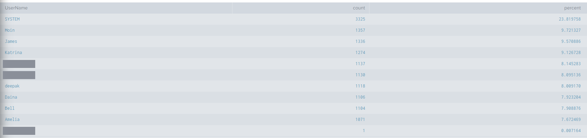
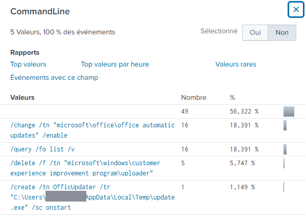
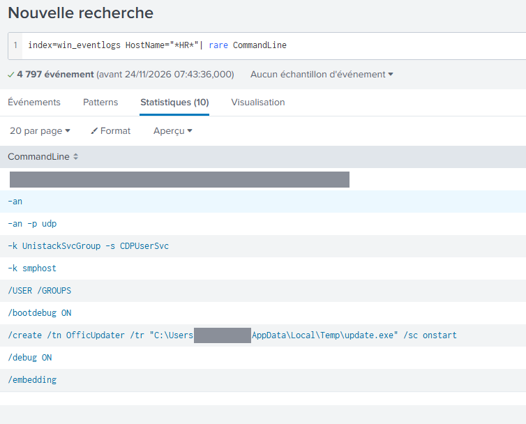
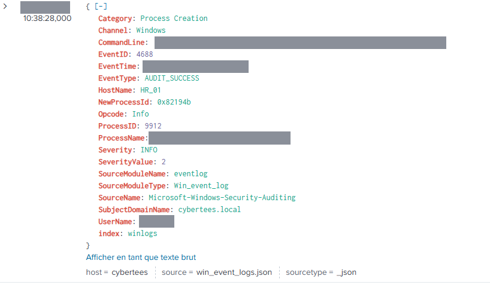

## Contexte & hypothèse

L'IDS d'un client signale une exécution de processus suspecte : un poste du service RH serait compromis. Des outils de collecte d'informations réseau et de tâches planifiées ont été lancés. Matériel fourni : seulement les journaux de **création de processus** (Event ID 4688), ingérés dans Splunk dans l'index `win_eventlogs`, et la liste des utilisateurs par service :

| Service | Utilisateurs |
| --- | --- |
| IT | James, Moin, Katrina |
| RH | Haroon, Chris, Diana |
| Marketing | Bell, Amelia, Deepak |

**Hypothèse de départ :** un utilisateur RH a lancé un outil système pour télécharger un payload. Avec seulement des 4688, tout passe par la ligne de commande (`CommandLine`), l'utilisateur (`UserName`) et le poste (`HostName`).

## Volume de journaux

:::question
Combien de journaux ont été ingérés pour mars 2022 ?
:::

:::demarche
J'interroge l'index sur toute la période. Le compte d'événements s'affiche sous la barre de recherche. Les journaux de l'index datent tous de mars 2022 : le total répond à la question. Pour en être sûr, on peut régler la période sur mars 2022 et vérifier que le compte ne change pas.
:::

```spl title="tous les journaux de l'index"
index=win_eventlogs
```

:::constat
Le volume donne l'ordre de grandeur : plus de dix mille créations de processus à trier. Impossible de tout lire, il faut faire ressortir l'anormal.
:::

## Le compte imposteur

:::question
Un compte imposteur apparaît dans les journaux : quel est son nom ?
:::

:::demarche
Je liste tous les `UserName` avec leur nombre d'événements, puis je les compare à la liste des utilisateurs fournie.
:::

```spl title="nombre d'événements par utilisateur"
index=win_eventlogs
| top limit=0 UserName
```



:::constat
Un compte imite le nom d'un utilisateur légitime à une lettre près : un chiffre à la place d'une lettre. Il n'a qu'**un seul** événement, contre plus de mille pour chaque vrai compte. Les deux indices se renforcent : un nom presque identique et un volume anormalement faible.
:::

## La tâche planifiée côté RH

:::question
Quel utilisateur du service RH exécute des tâches planifiées ?
:::

:::demarche
Les tâches planifiées se gèrent avec `schtasks`. Je recherche ce mot dans l'index, puis j'ouvre le champ `CommandLine` dans la liste de gauche pour voir ses valeurs avec leur nombre d'occurrences.
:::

```spl title="exécutions de schtasks"
index=win_eventlogs schtasks
```



:::constat
Les autres valeurs reviennent plusieurs fois. Une seule commande n'apparaît qu'**une fois** : `/create` crée une tâche `OfficUpdater` (un nom qui imite Office, avec une faute) qui lance un `update.exe` depuis le dossier `Temp` d'un utilisateur, à chaque démarrage (`/sc onstart`). C'est un mécanisme de persistance. Le nom de l'utilisateur se lit dans le chemin de l'exécutable : c'est un compte du service RH. Voir [Tâches planifiées (schtasks)](../../02-outils/lolbins-windows.md#tâches-planifiées-schtasks).
:::

## Le téléchargement par un LOLBin

:::question
Quel utilisateur RH a utilisé un binaire système (LOLBin) pour télécharger un payload, avec quel binaire, et à quelle date ?
:::

:::demarche
Je limite la recherche aux postes RH (leur nom contient `HR`) et je demande les lignes de commande **les plus rares** avec `rare` : une commande malveillante est ponctuelle, noyée au milieu de commandes qui se répètent. Une fois la ligne repérée, je clique dessus pour afficher l'événement complet : `UserName` donne l'utilisateur et `EventTime` la date.
:::

```spl title="lignes de commande les plus rares sur les postes RH"
index=win_eventlogs HostName="*HR*"
| rare CommandLine
```





:::constat
La ligne la plus rare est un téléchargement : un binaire Windows signé par Microsoft, appelé avec une URL et un nom de fichier. C'est ce qui lui permet de passer les contrôles de sécurité. On retrouve aussi la commande `schtasks /create` de l'étape précédente. Voir la fiche [LOLBins Windows](../../02-outils/lolbins-windows.md).
:::

## Le payload et le C2

:::question
Depuis quel site tiers le payload a-t-il été téléchargé, sous quel nom a-t-il été enregistré, et à quelle URL le poste s'est-il connecté ?
:::

:::demarche
Tout est dans la même ligne de commande, il suffit de la découper : l'URL, le domaine de cette URL (un site de partage de texte), puis le dernier argument, le nom du fichier écrit sur le disque.
:::

:::constat
Une seule ligne de commande donne trois IOC : le domaine, l'URL complète et le nom du fichier déposé. Ce sont eux qu'on bloque et qu'on recherche sur les autres postes.
:::

## Le contenu du payload

:::question
Le fichier téléchargé contient un motif au format `THM{…}` : lequel ?
:::

:::demarche
J'ouvre l'URL trouvée à l'étape précédente. Dans le challenge, on l'ouvre directement ; sur une vraie enquête, une adresse de C2 s'ouvre depuis un environnement isolé.
:::

:::constat
Le contenu de la page donne le motif.
:::

## Ce que j'en retiens

:::points
- **`rare` avant `top`.** Sur des milliers de 4688, l'attaque se cache dans les valeurs qui n'apparaissent qu'une fois : `rare CommandLine` sur le bon périmètre (`HostName="*HR*"`) l'a sortie en tête.
- **Comparer les comptes à la liste connue.** Un nom presque identique avec un seul événement trahit un imposteur.
- **Lire la ligne de commande en entier.** Elle donne l'utilisateur (chemin dans `C:\Users\…`), le mécanisme (`/sc onstart`) et les IOC (URL, fichier).
- **Un binaire signé n'est pas un binaire sûr.** Un outil système qui télécharge depuis un site de partage reste un téléchargement suspect.
:::
