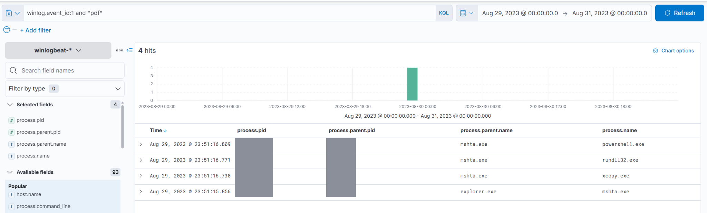

## Contexte & hypothèse

Après deux attaques du groupe Boogeyman, Quick Logistics LLC a confié son SOC à un prestataire. Le groupe était pourtant toujours là, et il revient. Matériel fourni : une instance Elastic avec les journaux des postes (vue `winlogbeat-*`), à explorer dans **Discover**.

**Hypothèse de départ :** comme les fois précédentes, un fichier piégé ouvert par un employé, puis une progression dans le réseau. Les journaux Sysmon (création de processus, connexions réseau) permettent de suivre chaque étape en remontant la filiation des processus : chaque processus malveillant mène à ses enfants.

## Le stage 1

:::question
Quel est le PID du processus qui a exécuté le stage 1 ?
:::

:::demarche
Je règle d'abord la période sur les dates de l'attaque (du 29 au 31 août 2023). Le stage 1 se fait passer pour un PDF : je cherche les créations de processus (Sysmon, Event ID 1) qui mentionnent `pdf`, et j'ajoute en colonnes `process.pid`, `process.parent.pid`, `process.parent.name`, `process.name` et `process.command_line`.
:::

```kql title="créations de processus liées au faux PDF"
winlog.event_id:1 and *pdf*
```



:::constat
Quatre résultats, tous à la même seconde. `explorer.exe` (le double-clic de l'utilisateur) lance `mshta.exe` sur un fichier en `.pdf.hta` : une **double extension**, qui montre « pdf » mais ouvre une application HTML. Les trois autres processus ont `mshta.exe` pour parent : son PID est celui du stage 1. Voir [Mshta](../../02-outils/lolbins-windows.md#mshta).
:::

## Le fichier implanté

:::question
Quelle commande a copié le fichier implanté, et quelle commande l'a exécuté ?
:::

:::demarche
Les deux réponses sont dans les résultats précédents, colonne `process.command_line` : les enfants de `mshta.exe` montrent ce que fait le stage 1.
:::

:::constat
`xcopy.exe` copie un fichier `.dat` depuis le lecteur `D:` vers le dossier `Temp` de l'utilisateur, puis `rundll32.exe` l'exécute comme une DLL, en appelant sa fonction `DllRegisterServer`. L'extension `.dat` ne veut rien dire : c'est une DLL. Voir [Rundll32](../../02-outils/lolbins-windows.md#rundll32).
:::

## La tâche planifiée

:::question
Quel est le nom de la tâche planifiée créée par le stage 1 ?
:::

:::demarche
Le troisième enfant de `mshta.exe` est un PowerShell. Une tâche planifiée créée en PowerShell passe par `New-ScheduledTaskAction` : je cherche cette chaîne.
:::

```kql title="création de tâche planifiée en PowerShell"
*New-ScheduledTaskAction*
```

:::constat
La commande construit la tâche pièce par pièce : l'action (`rundll32.exe` sur la copie du fichier dans `Temp`), le déclencheur (chaque jour à 06:00), puis `Register-ScheduledTask` suivi du nom de la tâche. L'implant se relance donc tous les matins. Voir [Tâche planifiée](../../03-menaces-detection/persistence/tache-planifiee.md).
:::

## La connexion C2

:::question
Quelles IP et port la connexion C2 de l'implant utilise-t-elle ?
:::

:::demarche
Les connexions réseau sont dans l'Event ID 3 de Sysmon. Je les affiche, puis je regarde les valeurs les plus fréquentes du champ `destination.ip`, et de `destination.port` pour le port.
:::

```kql title="connexions réseau (Sysmon 3)"
winlog.event_id: 3
```

:::constat
Une IP domine nettement les connexions : un implant qui rappelle son C2 en boucle produit beaucoup plus de connexions que le reste. Pour en être sûr, on peut ajouter `process.name` à la requête : les connexions doivent venir du processus de l'implant.
:::

## Le contournement de l'UAC

:::question
Quel processus l'attaquant a-t-il utilisé pour contourner l'UAC ?
:::

:::demarche
Tout ce que l'attaquant lance passe désormais par l'implant : je cherche les processus dont le parent a le fichier `.dat` dans sa ligne de commande.
:::

```kql title="processus lancés par l'implant"
process.parent.command_line: *review.dat*
```

:::constat
Les enfants racontent la suite dans l'ordre : `whoami /all`, `net users`, `net localgroup administrators`, puis `whoami /groups`. L'attaquant vérifie ses droits et découvre que le compte est administrateur local, mais limité par l'UAC. Juste après, il lance deux fois un binaire Windows qui s'élève automatiquement sans afficher d'invite UAC : c'est le contournement.
:::

## Le vol d'identifiants

:::question
Depuis quel lien GitHub l'outil de vol d'identifiants a-t-il été téléchargé, et quel couple compte et hash l'attaquant a-t-il obtenu ?
:::

:::demarche
Avec des droits élevés, l'attaquant télécharge un outil. Je cherche simplement `github` dans les journaux : la ligne de commande du téléchargement donne le lien. Je cherche ensuite les processus dont le parent est cet outil (`process.parent.name`).
:::

:::constat
L'outil lance un PowerShell **avec le hash NTLM d'un autre compte**, sans connaître son mot de passe : c'est un *pass-the-hash*. Le nom du compte et le hash se lisent dans la ligne de commande.
:::

## Le partage distant et les nouveaux identifiants

:::question
Quel fichier l'attaquant a-t-il lu sur un partage distant, quels identifiants y a-t-il trouvés, et vers quelle machine a-t-il tenté de se déplacer ?
:::

:::demarche
Avec la session ouverte par le pass-the-hash, je cherche les créations de processus liées au dossier de l'outil. Une commande lit un script sur un partage réseau ; la suivante réutilise ce qu'il contenait.
:::

:::constat
Le script contenait un identifiant et un mot de passe en clair. L'attaquant les utilise aussitôt dans une commande `Invoke-Command -Credential … -ComputerName …` : le mot de passe apparaît en clair dans la ligne de commande (`ConvertTo-SecureString … -AsPlainText`), et le nom de la machine visée aussi.
:::

## La commande sur la seconde machine

:::question
Quel est le processus parent de la commande exécutée sur la seconde machine ?
:::

:::demarche
Je passe côté cible : les processus de la seconde machine lancés par le compte utilisé dans `Invoke-Command`.
:::

```kql title="commandes du compte sur la seconde machine"
host.hostname: "<seconde machine>" and user.name: "<compte>" and process.command_line: *
```

:::constat
La commande envoyée par `Invoke-Command` (ici un simple `whoami`) n'a pas pour parent PowerShell, mais le processus qui héberge les sessions PowerShell à distance, lui-même lancé par `svchost.exe`. C'est ce parent qui signe une exécution à distance de ce type.
:::

## Le contrôleur de domaine

:::question
Quel hash l'attaquant a-t-il obtenu sur la seconde machine, et quel compte, en plus de l'administrateur, a-t-il récupéré par DCSync ?
:::

:::demarche
Même méthode qu'au début : les processus dont le parent est l'outil de vol d'identifiants, cette fois sur la seconde machine, puis sur le contrôleur de domaine `DC01`.
:::

:::constat
Sur la seconde machine, l'outil donne le hash d'un compte administrateur. Sur `DC01`, la commande **DCSync** demande au contrôleur de domaine de lui transmettre les hashes d'un compte, comme le ferait un autre contrôleur lors d'une réplication. L'attaquant l'utilise pour l'administrateur et pour un second compte, dont le nom figure après `/user:`.
:::

## Le rançongiciel

:::question
Quel lien l'attaquant a-t-il utilisé pour télécharger le rançongiciel ?
:::

:::demarche
Le contrôleur de domaine est le dernier point de contrôle de l'attaquant : je regarde les commandes PowerShell qui y ont été lancées.
:::

```kql title="commandes PowerShell sur le contrôleur de domaine"
host.hostname: "DC01" and process.name: "powershell.exe" and process.command_line: *
```

:::constat
Depuis `DC01`, un `Invoke-Command` vers un autre poste télécharge le rançongiciel avec `iwr` et l'enregistre sur ce poste. Le contrôleur de domaine sert de point de départ pour déployer la charge finale.
:::

## Timeline reconstituée

Heures telles qu'affichées dans Kibana.

:::timeline
| Heure | Événement | Source |
| --- | --- | --- |
| 29/08 23:51:15 | `mshta.exe` ouvre le faux PDF (`.pdf.hta`). | Sysmon 1 |
| 29/08 23:51:16 | Copie du fichier `.dat`, exécution par `rundll32.exe`, création de la tâche planifiée. | Sysmon 1 |
| 29/08 23:53 | Reconnaissance : `whoami /all`, `net users`, `net localgroup administrators`, `whoami /groups`. | Sysmon 1 |
| 29/08 23:54:49 | Contournement de l'UAC. | Sysmon 1 |
| 30/08 00:20 | Commande à distance sur la seconde machine avec les identifiants trouvés. | Sysmon 1 |
| 30/08 01:47:57 | DCSync depuis le contrôleur de domaine. | Sysmon 1 |
| 30/08 02:01:14 | Téléchargement du rançongiciel lancé depuis le contrôleur de domaine. | Sysmon 1 |

:::

## Ce que j'en retiens

:::points
- **Fixer la période, puis choisir ses colonnes.** PID, PID parent, nom du parent, nom et ligne de commande : avec ces cinq colonnes, la filiation se lit directement dans le tableau.
- **Suivre les enfants.** `process.parent.command_line` ou `process.parent.name` sur un processus malveillant donne tout ce qu'il a lancé : c'est le fil de toute l'enquête.
- **La double extension trompe l'œil.** Un `.pdf.hta` ouvert par `mshta.exe` n'est pas un PDF.
- **Les identifiants circulent en clair.** Script sur un partage, `-AsPlainText` dans une ligne de commande : les journaux de processus les gardent.
- **Le parent dit d'où vient une commande.** Une commande lancée à distance n'a pas le même parent qu'une commande tapée sur place.
:::
