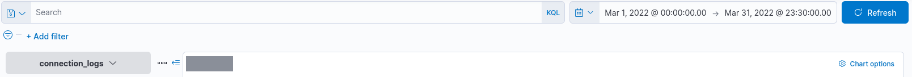
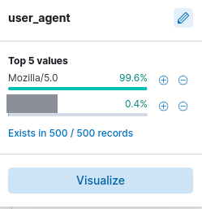
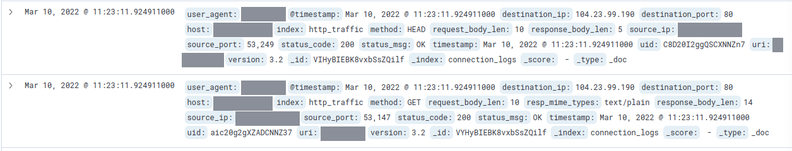

## Contexte & hypothèse

Un IDS a levé une alerte sur une possible communication avec un serveur de commande et contrôle (C2). Matériel fourni : un accès à Kibana, avec les journaux de connexion du réseau dans l'onglet **Discover** (vue de données `connection_logs`, index `http_traffic`).

**Hypothèse de départ :** un poste du réseau parle à un serveur de l'attaquant. Il faut trouver lequel, avec quel programme, vers quel site, et ce qu'il y a récupéré.

## Délimiter la période

:::question
Combien d'événements ont été enregistrés en mars 2022 ?
:::

:::demarche
Je règle la période dans le sélecteur de dates, en dates absolues : du 1er mars 2022 à 00:00 au 31 mars 2022. Le nombre de résultats (*hits*) s'affiche au-dessus de l'histogramme.
:::

:::constat
Le compte se lit directement en *hits*. Sur la capture, la fin de période est réglée à 23:30 : pour couvrir tout le mois, il faut aller jusqu'au 31 à 23:59:59. Ici, ça n'a rien changé au compte.
:::

## Repérer le poste et le programme suspects

:::question
Quelle IP est associée à l'utilisateur suspect, et quel binaire Windows légitime a servi à télécharger un fichier depuis le C2 ?
:::

:::demarche
Je commence par le champ `source_ip`, dans la liste de gauche : deux IP seulement, rien qui permette de choisir. Je regarde alors `user_agent`, le champ qui dit quel programme a fait la requête HTTP. Ses valeurs les plus fréquentes montrent l'anomalie : 99,6 % de `Mozilla/5.0` (des navigateurs), et 0,4 % d'une seule autre valeur, qui n'est pas un navigateur mais le nom d'un outil Windows. Je l'ajoute en filtre avec le « + » à côté de la valeur : il reste deux événements.
:::

:::constat
Les deux événements filtrés viennent de la même `source_ip` : c'est le poste suspect. Et le binaire est celui qui apparaît dans `user_agent` : un outil d'administration légitime de Windows, utilisé pour télécharger, ce qui le fait passer inaperçu à côté du trafic des navigateurs.
:::

:::astuce
Chercher la valeur rare. Dans un champ comme `user_agent`, presque tout le trafic se ressemble : la valeur à 0,4 % est celle à regarder en premier. Les pourcentages de la liste de gauche sont calculés sur un échantillon (ici 500 événements), pas sur tous les résultats.
:::

## Le site qui sert de C2

:::question
À quel site de partage de fichiers, utilisé comme C2, le poste infecté s'est-il connecté ?
:::

:::demarche
Toujours avec le filtre sur le `user_agent`, je déplie les deux événements et je lis leurs champs : le champ `host` donne le site contacté.
:::

:::constat
Les deux requêtes partent du poste suspect vers un site de partage de texte bien connu, à la même seconde : un `HEAD`, puis un `GET` qui renvoie du `text/plain`. Un site légitime et répandu sert de C2 : son trafic se fond dans celui des utilisateurs.
:::

## L'URL complète du C2

:::question
Quelle est l'URL complète du C2 ?
:::

:::demarche
J'ajoute le champ `uri` en colonne. L'URL complète, c'est le `host` suivi de l'`uri` : le chemin de la ressource demandée sur le site.
:::

:::constat
Les deux requêtes demandent la même ressource. Assemblée avec le site, elle donne l'URL complète du C2 : l'IOC à bloquer et à rechercher sur les autres postes.
:::

## Le fichier récupéré

:::question
Quel fichier a été consulté sur le site de partage, et quel code secret contient-il ?
:::

:::demarche
J'ouvre l'URL trouvée à l'étape précédente : la page affiche le nom du fichier et son contenu. Dans le challenge, on l'ouvre directement ; sur une vraie enquête, une adresse de C2 s'ouvre depuis un environnement isolé, jamais depuis son poste.
:::

:::constat
Le fichier contient le code secret au format `THM{…}`.
:::

## Timeline reconstituée

Le 10 mars 2022, d'après les deux événements filtrés :

:::timeline
| Heure | Événement | Source |
| --- | --- | --- |
| 11:23:11 | Requête `HEAD` du poste suspect vers le site de partage, avec le user-agent d'un binaire Windows. | http_traffic |
| 11:23:11 | Requête `GET` sur la même ressource : le fichier texte est téléchargé. | http_traffic |

:::

## Ce que j'en retiens

:::points
- **Fixer la période d'abord.** Toute la suite se fait dans cette fenêtre : la régler en dates absolues évite de compter à côté.
- **Le user-agent trahit le programme.** Un outil système à la place d'un navigateur, c'est le signe d'un téléchargement fait par un binaire légitime détourné.
- **Les valeurs rares avant tout.** Les statistiques des champs, dans la liste de gauche, font ressortir l'anomalie en un clic.
- **Un C2 peut être un site légitime.** L'URL complète (`host` + `uri`), plus que le domaine seul, est l'IOC utile.
:::
