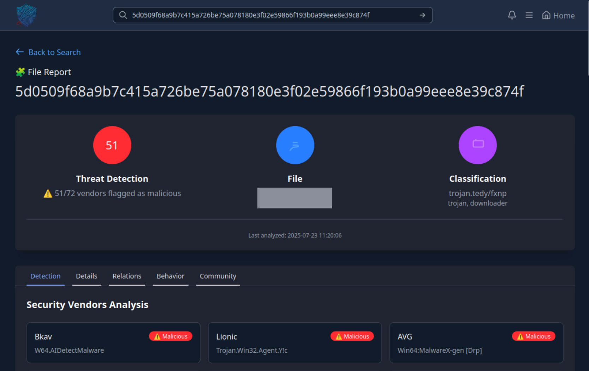
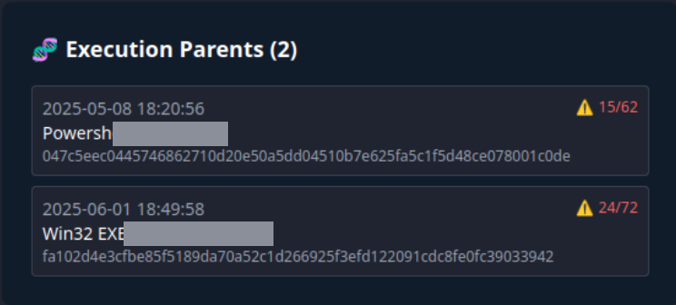

## Contexte & hypothèse

Analyste au SOC d'un hébergeur, j'épaule un L3 en réponse à incident. Un L1 a escaladé deux indicateurs dans la matinée : l'IP `101[.]99[.]76[.]120` et le hash SHA-256 `5d0509f68a9b7c415a726be75a078180e3f02e59866f193b0a99eee8e39c874f`. Outil : TryDetectThis2.0, une plateforme de threat intelligence qui ressemble à VirusTotal (détections, détails, relations, commentaires).

**Hypothèse de départ :** les deux indicateurs appartiennent à la même attaque. En partant du hash, puis de l'IP, il doit être possible de remonter jusqu'à la famille du malware et au rapport public qui décrit la campagne.

## Le fichier derrière le hash

:::question
Quel est le nom du fichier identifié par le hash, et son type ?
:::

:::demarche
Je recherche le hash dans TryDetectThis2.0. La première page du rapport donne l'essentiel : le score de détection, le nom et le type du fichier, et la classification proposée par les éditeurs. L'onglet **Details** confirme le type et ajoute les autres empreintes (MD5, SHA-1, imphash…) et l'historique des soumissions.
:::

:::constat
51 éditeurs sur 72 le jugent malveillant, classé comme cheval de Troie de type downloader : un fichier dont le rôle est de télécharger la suite de l'attaque. Le nom et le type se lisent dans le bloc « File ».
:::

## Remonter et descendre la chaîne

:::question
Quels fichiers ont lancé ce fichier, et quel fichier dépose-t-il ?
:::

:::demarche
L'onglet **Relations** relie le fichier à ceux qui l'entourent : ses **parents d'exécution** (les fichiers qui l'ont lancé) et ses **fichiers déposés** (ceux qu'il écrit sur le disque). Je relève les parents dans l'ordre chronologique, et surtout **leurs hashes**, qui permettront de pivoter.
:::

:::constat
Deux parents : un script PowerShell, puis un exécutable Win32, chacun avec son propre score de détection. Le fichier dépose lui-même un autre exécutable. On voit déjà la chaîne d'infection en plusieurs étapes : un script, un exécutable, puis le downloader.
:::

## Pivoter sur le parent

:::question
Quels fichiers malveillants le second parent dépose-t-il ?
:::

:::demarche
Je relance une recherche avec le hash du second parent, puis je lis ses **Relations › Dropped Files**. C'est le principe du pivot : chaque hash découvert devient un nouveau point de départ.
:::

:::constat
Ce parent dépose une vingtaine de fichiers, dont quatre malveillants en tête de liste : des exécutables (dont le fichier de départ) et des scripts VBS. Le fichier escaladé n'était qu'une pièce d'un ensemble plus large.
:::

## L'IP et la famille du malware

:::question
Quelle famille de malware relie les fichiers liés à l'IP ?
:::

:::demarche
Je recherche l'IP dans la plateforme et je lis l'onglet **Community**. Les commentaires d'autres analystes donnent souvent le contexte que les scores ne donnent pas : ici, un commentaire structuré comme un événement MISP, avec la famille, la campagne, les techniques ATT&CK et la référence du rapport d'origine.
:::

:::constat
Le commentaire identifie l'IP comme un serveur de commande et contrôle d'une famille de malware connue, et cite le titre et l'éditeur du rapport qui décrit la campagne (avec le producteur, les pays visés et une longue liste de techniques ATT&CK). C'est ce qui permet de passer d'indicateurs isolés à une campagne identifiée.
:::

## Le rapport public

:::question
Quel outil a servi à voler les cookies de Chrome, quelle technique de phishing a été utilisée, et quelle plateforme a servi à rediriger les victimes ?
:::

:::demarche
Je recherche le titre du rapport sur Google pour trouver la publication de l'éditeur, puis je la lis : un rapport de threat intelligence décrit en général toute la chaîne, de l'accès initial à l'exfiltration, avec les outils utilisés à chaque étape.
:::

:::constat
Le rapport répond aux trois questions : l'outil de vol de cookies, la technique de phishing qui pousse la victime à lancer elle-même une commande, et la plateforme légitime détournée pour rediriger vers les serveurs malveillants.
:::

## Timeline reconstituée

D'après les dates relevées dans la plateforme :

:::timeline
| Date | Événement | Source |
| --- | --- | --- |
| 2025-03-09 | Compilation du fichier escaladé. | Details › History |
| 2025-03-17 | Première soumission du fichier. | Details › History |
| 2025-05-08 | Premier parent d'exécution vu (script PowerShell). | Relations |
| 2025-06-01 | Second parent d'exécution vu (exécutable Win32). | Relations |
| 2025-06-21 | Commentaire reliant l'IP à la famille et au rapport. | Community |
| 2025-07-23 | Dernière analyse du fichier. | Details › History |

:::

## Ce que j'en retiens

:::points
- **Noter les hashes au fur et à mesure.** Chaque parent ou fichier déposé est un point de pivot : c'est en enchaînant les recherches qu'on reconstitue la chaîne.
- **Lire l'onglet Relations.** Parents d'exécution et fichiers déposés montrent l'infection en plusieurs étapes mieux que le score seul.
- **Ne pas négliger les commentaires.** La communauté relie souvent un indicateur à une famille, une campagne et un rapport public : la porte d'entrée vers le renseignement complet.
:::
